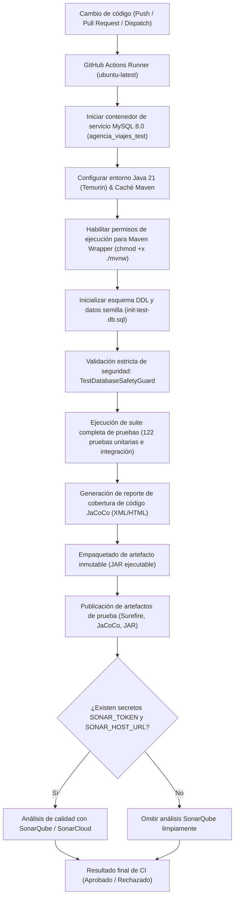

# Integración Continua (CI) con GitHub Actions – AgencyTrip API

Este documento describe la arquitectura, configuración, ejecución y políticas de seguridad del pipeline de integración continua implementado para el backend de **AgencyTrip CO** (`agencytrip-api`), desarrollado con **Spring Boot 4**, **Java 21** y **Maven Wrapper**.

---

## 1. Diagrama de Flujo del Pipeline



---

## 2. Workflows Disponibles

### `Backend CI - AgencyTrip API` (`.github/workflows/backend-ci.yml`)

- **Eventos disparadores:**
  - `push` en las ramas: `DEV`, `PRE`, `PROD`, `main`.
  - `pull_request` hacia las ramas: `DEV`, `PRE`, `PROD`, `main`.
  - `workflow_dispatch`: Ejecución manual desde la interfaz web de GitHub.
- **Permisos mínimos:** `permissions: contents: read`.
- **Runner:** `ubuntu-latest`.
- **Tiempo límite:** Basado en timeout estándar de GitHub Actions (cancelación automática en caso de bloqueo).

---

## 3. Pruebas Ejecutadas

El pipeline ejecuta la totalidad de las **122 pruebas automatizadas** del backend mediante `./mvnw clean test`:

1. **Pruebas unitarias de dominio y servicios:** Validación de reglas de negocio en destinos, paquetes, transporte, hoteles, usuarios y reservas con JUnit 5 y Mockito.
2. **Pruebas de controladores web (MockMvc):** Validación de rutas públicas y protegidas, códigos de respuesta HTTP, manejo global de excepciones y validación de esquemas JSON.
3. **Pruebas de seguridad Spring Security / JWT:** Validación de autenticación basada en tokens, firma HMAC-SHA256, expiración, emisor (`iss`) y audiencia (`aud`).
4. **Pruebas de integración y concurrencia MySQL:** Escenarios de concurrencia de reservas sobre la base de datos real `agencia_viajes_test` para garantizar que no existan sobreventas ni inconsistencias transaccionales.

---

## 4. Entorno de Ejecución y Dependencias

- **Versión de Java:** Java 21 LTS (distribución Eclipse Temurin oficial).
- **Gestor de compilación:** Maven Wrapper (`./mvnw`), garantizando que la versión exacta de Maven y sus plugins sean deterministas en cualquier entorno.
- **Caché:** Caché administrada para dependencias Maven (`~/.m2`), optimizando los tiempos de compilación.

---

## 5. Configuración y Aislamiento de Base de Datos de Pruebas

### Contenedor de Servicio MySQL

El workflow levanta un contenedor oficial de servicio de MySQL 8.0 en el runner:

- **Imagen:** `mysql:8.0`.
- **Puerto:** `3306:3306`.
- **Healthcheck:** `mysqladmin ping --silent` con reintentos para asegurar que el motor esté listo antes de iniciar las pruebas.
- **Base de datos creada por el servicio:** Exclusivamente `agencia_viajes_test`.

### Inicialización de Datos

El script DDL [`init-test-db.sql`](file:///C:/Agencia%20de%20Viajes/agencytrip-api/src/test/resources/init-test-db.sql) se aplica contra `agencia_viajes_test` utilizando variables de entorno de sesión (`MYSQL_PWD`), garantizando que no se impriman contraseñas en los logs de ejecución.

### Protección Activa: `TestDatabaseSafetyGuard`

El componente [`TestDatabaseSafetyGuard.java`](file:///C:/Agencia%20de%20Viajes/agencytrip-api/src/main/java/com/agencytrip/agencytripapi/infrastructure/config/TestDatabaseSafetyGuard.java) protege de forma absoluta la integridad de los datos:

1. Se activa automáticamente bajo el perfil `test` (`@Profile("test")`).
2. Inspecciona la conexión JDBC efectiva (`connection.getCatalog()` y `metaData.getURL()`).
3. Si la conexión apunta a la base de datos de producción (`agencia_viajes`) o a cualquier esquema diferente de `agencia_viajes_test`, arroja inmediatamente una excepción crítica `IllegalStateException`, abortando el proceso antes de que JPA o Hibernate ejecuten cualquier sentencia.

---

## 6. Consulta de Resultados y Artefactos

Al finalizar la ejecución del workflow, los siguientes artefactos quedan disponibles para descarga en la sección **Actions** del repositorio (pestaña del build específico):

| Artefacto                  | Ruta en el runner             | Retención | Propósito                                                                      |
| :------------------------- | :---------------------------- | :-------: | :----------------------------------------------------------------------------- |
| `backend-surefire-reports` | `target/surefire-reports/`    |  14 días  | Reportes detallados XML/TXT con los resultados de cada prueba JUnit ejecutada. |
| `backend-jacoco-report`    | `target/site/jacoco/`         |  14 días  | Reporte completo de cobertura de líneas, ramas e instrucciones (XML y HTML).   |
| `agencytrip-api-artifact`  | `target/agencytrip-api-*.jar` |  7 días   | Archivo JAR ejecutable generado en la fase de empaquetado inmutable.           |

---

## 7. Integración con SonarQube / SonarCloud

### Situación actual

La instancia de SonarQube del proyecto opera localmente en `http://localhost:9000`. Dado que los runners alojados en la nube de GitHub Actions no tienen conectividad hacia redes privadas locales, **el pipeline no intenta conectarse a `localhost:9000` ni expone el servidor local**.

### Ejecución opcional y desacoplada

El paso de análisis estático está configurado condicionalmente:

```yaml
if: ${{ secrets.SONAR_TOKEN != '' && secrets.SONAR_HOST_URL != '' }}
```

- **Si los secretos no están definidos:** El paso se omite limpiamente y el workflow finaliza en estado exitoso si las pruebas y el build aprueban.
- **Para activar el análisis en una instancia remota o SonarCloud:**
  1. Ingresar a GitHub: `Settings -> Secrets and variables -> Actions`.
  2. Crear el secreto `SONAR_HOST_URL` con la URL pública o institucional del servidor SonarQube (ej. `https://sonarcloud.io` o `https://sonar.midominio.com`).
  3. Crear el secreto `SONAR_TOKEN` con el token de análisis generado en SonarQube.
  4. Una vez guardados, los siguientes builds ejecutarán automáticamente el análisis sin requerir modificaciones en el archivo YAML.

---

## 8. Relación con "The Twelve-Factor App"

La configuración de este pipeline evidencia la aplicación concreta de los siguientes principios de Twelve-Factor App:

1. **Factor I – Base de código (Codebase):** Existe una base de código única rastreada en Git para `agencytrip-api`, desde la cual se derivan los múltiples entornos (DEV, PRE, PROD) validados por el mismo pipeline.
2. **Factor III – Configuraciones (Config):** Las credenciales y configuraciones no se almacenan en código ni en archivos YAML; se suministran estrictamente a través de variables de entorno (`DB_URL`, `DB_USERNAME`, `DB_PASSWORD`, `SPRING_PROFILES_ACTIVE`, `JWT_SECRET`).
3. **Factor IV – Servicios de respaldo (Backing Services):** La base de datos MySQL es tratada como un recurso conectado intercambiable; el código de la aplicación se conecta transparentemente a la instancia efímera de CI o a la base de producción sin alterar la lógica de negocio.
4. **Factor V – Construcción, lanzamiento, ejecución (Build, Release, Run):** Separación estricta de etapas: el build compila y prueba el código, genera el reporte de cobertura y empaqueta un artefacto inmutable (`agencytrip-api-*.jar`) desacoplado de su eventual despliegue.
5. **Factor X – Paridad en desarrollo y producción (Dev/Prod Parity):** Las pruebas de integración se ejecutan contra una instancia real de MySQL 8.0 en lugar de recurrir a bases de datos en memoria (H2), evitando discrepancias de dialectos SQL, bloqueos de concurrencia y restricciones relacionales.
